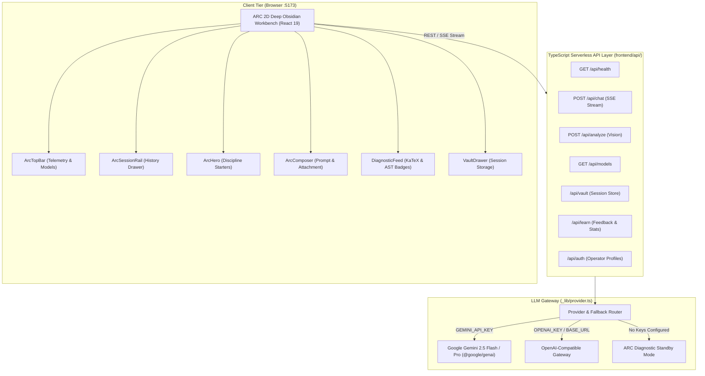
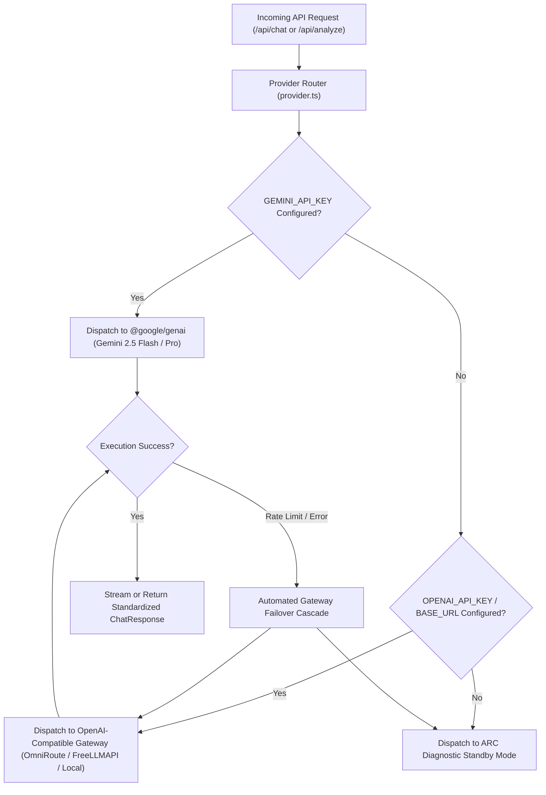
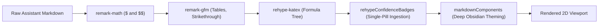

# ARC — System Architecture & Technical Specification

This document details the software architecture, runtime topology, data flows, and component specifications of the **ARC** academic reasoning workbench.

---

## 1. System Overview & Architecture Topology

ARC is an AI-powered multi-discipline engineering command center and diagnostic assistant tailored for engineering students, researchers, and professional practitioners specializing in **Electrical & Electronics (ECE)**, **Computer Science & Digital Systems**, **Applied Mathematics**, **Mechanical & Thermodynamics**, and **Civil Engineering**.

The application is deployed as a unified, high-performance web platform combining a **React 19 + TypeScript + Vite 8 + Tailwind CSS v4** frontend with an integrated **TypeScript on Node.js Serverless API layer**. LLM query orchestration and multimodal vision route through a multi-provider gateway supporting Google Gemini and OpenAI-compatible endpoints.



---

## 2. 2D "Deep Obsidian" Engineering Design System

ARC utilizes a high-contrast, technical 2D aesthetic engineered for focus and zero visual fatigue during demanding derivation sessions:

### Color Palette & Token Hierarchy

| Design Token | Value | Semantic Role |
| :--- | :--- | :--- |
| **Base Canvas** | `#05060F` | Deep Obsidian background canvas with `.arc-dot-grid` coordinate overlay |
| **Surface Level 1** | `#0B0D1D` | Primary cards, optical scope viewport, composer dock, and KaTeX containers |
| **Surface Level 2** | `#10132A` | Elevated popovers, command palette modal, and active selection pills |
| **Surface Hover** | `#161A38` | Interactive hover states and table row highlights |
| **Crisp 1px Border** | `#1B2042` | Solid default technical border for card and component separation |
| **Subtle Border** | `rgba(43, 59, 255, 0.22)` | Electric Indigo tinted boundary with specular micro-highlight |
| **Primary Active** | `#2B3BFF` | Electric Indigo focus rings, primary action triggers, and math indicators |
| **Precision Telemetry**| `#35FEE4` | Tropical Mint telemetry shimmer, streaming cursor, and verified inline tokens |
| **Primary Text** | `#F4F6FB` | Ultra-high contrast text for headers, derivations, and math symbols |
| **Secondary Text** | `#94A3B8` | Subheadings, parameter descriptions, and secondary metadata |
| **Muted Text** | `#64748B` | Timestamps, cycle counts, units, and inactive labels |

### Architectural Coordinate Dot Overlay (`.arc-dot-grid`)
- Background: `radial-gradient(rgba(43, 59, 255, 0.20) 1px, transparent 1px)`
- Grid size: `24px 24px`
- Renders an unobtrusive engineering blueprint coordinate canvas across the workbench.

---

## 3. Frontend Architecture & Component Topology

The React 19 application lives entirely in `frontend/src/` with a component hierarchy built for speed, keyboard navigation, and cognitive clarity:

```text
frontend/src/
├── main.tsx                    # React root, KaTeX stylesheet, index.css
├── App.tsx                     # Main ARC workbench shell, state machines, DUT scope
├── api.ts                      # Client wrappers for chat, analyze, vault, and models
├── index.css                   # Deep Obsidian design tokens, scrollbars, KaTeX overrides
├── components/
│   ├── ArcTopBar.tsx           # Pinned top telemetry bar, health LED, model selector, bench reset
│   ├── ArcSessionRail.tsx      # Slide-out collapsible engineering session drawer
│   ├── ArcHero.tsx             # Focused engineering hero studio & discipline starters
│   ├── ArcComposer.tsx         # Multi-discipline prompt composer with image drop/paste & voice
│   ├── ArcCommandPalette.tsx   # Command palette modal (Ctrl+K / Cmd+K)
│   ├── DiagnosticFeed.tsx      # Real-time streaming chat feed with KaTeX math & AST badges
│   └── VaultDrawer.tsx         # Slide-over Knowledge Vault for pinned derivations & lab notes
└── hooks/                      # Custom hooks (file attachment, audio recording, etc.)
```

### Component Roles & Invariants
1. **`ArcTopBar.tsx`**:
   - Fixed `h-[56px]`, glass surface (`rgba(11, 13, 29, 0.85)`).
   - Telemetry status LED querying `GET /api/health` (`SYS ONLINE`, `INITIALIZING`, `STANDBY`).
   - Active provider/model selector chip with direct routing override.
   - `RESET BENCH` action to clean memory and unmount all active inspection files.
2. **`ArcSessionRail.tsx`**:
   - Fast session switching and local session history persistence.
3. **`ArcComposer.tsx`**:
   - Auto-resizing textarea with <kbd>Enter</kbd> to send and <kbd>Shift+Enter</kbd> for multi-line formulas.
   - Drag-and-drop, file browser, and global clipboard paste (<kbd>Ctrl+V</kbd>) attachment handlers.
   - Response style toggles: `Engineering Rigor`, `Natural Dialogue`, and `High-Density Concise`.
4. **`DiagnosticFeed.tsx`**:
   - Height-locked scrollable log styled with `.diagnostic-feed-scrollbar`.
   - Assistant message bubbles wrapped in `.arc-card-elevated`.
   - Streaming text animation via `.streaming-cursor` and `.shimmer-text`.

---

## 4. TypeScript Serverless API Layer (`frontend/api/`)

The API layer is implemented completely in TypeScript on Node.js:

### Endpoint Specifications
1. **`GET /api/health`**:
   - Returns service liveness, active provider configuration, and default model resolution. `available_providers` lists SDKs detected in environment.

2. **`POST /api/chat`**:
   - Accepts `ChatRequest` payloads (`message`, `history`, `model`, `provider`, `style`, `privacy_mode`, `stream`).
   - Supports **Server-Sent Events (SSE)** streaming (`text/event-stream`) emitting `step`, `chunk`, `done`, and `error` events.
   - Non-streaming returns deterministic `ChatResponse` with `provider`, `model_id`, `attempts`, and `fallback_used`.

3. **`POST /api/analyze`**:
   - Accepts base64 image data (data URI or raw) and MIME type for multimodal circuit, schematic, or formula visual analysis.
   - Dispatches visual tokens to active vision provider (Gemini multimodal vision 或 OpenAI-compatible vision endpoint).

4. **`GET /api/models`**:
   - Returns model registry with `id`, `label`, `provider`, `specialty`, and `supports_vision` flags.
   - Available models: `auto` (ARC router), `gemini-2.5-flash`, `gemini-2.5-pro`, `openai-gateway`.

5. **`/api/vault/sessions`**:
   - In-memory session store for current operator. No persistent storage yet.
   - Supports CRUD on session snapshots (list, create, read, delete).

6. **`/api/learn/stats`**:
   - Returns static knowledge vault statistics (total documents, chunks, branch breakdowns).

   **PLANNED**:
   - Persistent storage migration (SQLite or file system)
   - Real document ingestion with chunking
   - Vector embeddings and semantic search
   - Retrieval-augmented generation context injection

---

## 5. LLM-First RAG Intelligence Gateway & Security Isolation

The gateway (`frontend/api/_lib/provider.ts`) routes queries through a multi-provider hierarchy:



### Provider Architecture & Invariants
- **Google Gemini**: Uses `@google/genai` SDK when `GEMINI_API_KEY` is configured. Defaults to `gemini-2.5-flash`, optionally overridden by `gemini-2.5-pro`. Supports native multimodal vision, streaming text, and high-precision KaTeX formula synthesis.
- **OpenAI-Compatible Gateway**: Routes to any OpenAI-compatible HTTP endpoint via `OPENAI_API_KEY` and optional `OPENAI_BASE_URL`. Example backends: cloud proxies, local gateways (Ollama, vLLM), or custom API routers.
- **ARC Diagnostic Standby Mode**: If no API keys are detected (`GEMINI_API_KEY` or `OPENAI_API_KEY` + `OPENAI_BASE_URL`), returns deterministic standby responses explaining setup instructions instead of crashing or returning blank assistant bubbles. Used during development and without credentials configured.
- **Route Resolution Logic** ([`provider.ts:253-466`](frontend/api/_lib/provider.ts#L253-L466)):
  1. Explicitly requested `provider === 'openai'` OR OpenAI configured AND not requesting Gemini → Dispatch to OpenAI gateway.
  2. Gateway unavailable OR not configured → Dispatch to Google Gemini (if key present).
  3. No provider keys → Resolve to ARC Diagnostic Standby Mode.
- **Strict Prohibition on Groq**: Groq endpoints and integrations are strictly prohibited (`no Groq`).
- **Zero Secret Exposure**: API keys are read strictly from environment variables (`GEMINI_API_KEY`, `OPENAI_API_KEY`, `OPENAI_BASE_URL`). Authorization headers and credentials are never logged, echoed, or included in client payloads in any response.

---

## 6. Rendering Pipeline & AST Transformations

To render academic engineering content cleanly without layout shifts or border artifacts, assistant Markdown is processed through an AST pipeline:



### 1. `rehypeConfidenceBadges` Plugin
- Walks the HTML Abstract Syntax Tree (HAST) and identifies confidence tokens:
  - `CONFIRMED` -> Emerald badge (`badge-success`)
  - `LIKELY` -> Amber badge (`badge-warm`)
  - `CANNOT CONFIRM` -> Rose badge (`badge-danger`)
- Skips `<code>`, `<pre>`, and `.katex` nodes to prevent corrupting code snippets or formulas.
- Replaces tokens in-place to guarantee single-pill badges without nested parent borders.

### 2. KaTeX Mathematical Notation Overrides
- **Inline**: Enclosed in single dollar signs: `$f_c = \frac{1}{2\pi R C}$`
- **Display Blocks**: Enclosed in double dollar signs: `$$A_v = -\frac{R_f}{R_{in}}$$`
- **Deep Obsidian Constraints**:
  - Overridden with `#F4F6FB` text color and `text-rendering: auto`.
  - `.katex-display` is wrapped in `#0B0D1D` background with `1px solid #1B2042` and a `2px solid #2B3BFF` left telemetry accent.
  - Constrained with `overflow-x: auto` and `overflow-y: hidden` to prevent formula clipping on mobile viewports.

---

## 7. Memory Management & Object URL Lifecycle

ARC manages image preview memory deterministically using `activeObjectUrlsRef` in `frontend/src/App.tsx`:

1. When a user uploads, drops, or pastes an image, an object URL is generated via `URL.createObjectURL(file)`.
2. The URL string is added to `activeObjectUrlsRef.current: Set<string>`.
3. When clearing the draft attachment (`removeAttachedFile`), `imagePreview` is revoked only if it does not equal `activeDutImage`.
4. When resetting the workbench (`handleClearChat`), `activeObjectUrlsRef` iterates through all stored URLs and executes `URL.revokeObjectURL(url)` before clearing the set.
5. On component unmount, a cleanup hook safely revokes all remaining URLs.

---

## 8. Verification & Engineering Discipline

Every modification to the codebase must be validated before completion using the project's verification protocol:

```powershell
cd frontend
npm run lint    # oxlint: 0 errors, 0 warnings
npm run build   # tsc -b && vite build: exit code 0
```
